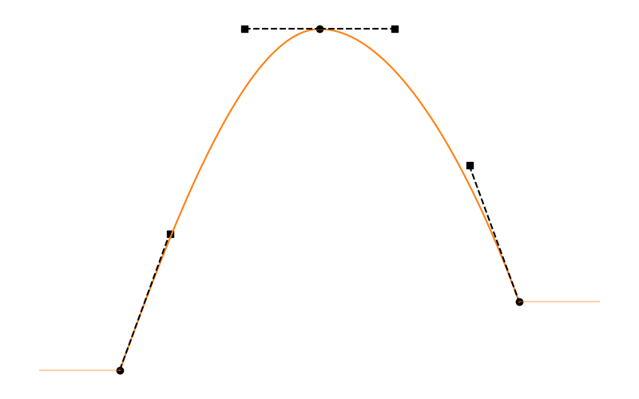
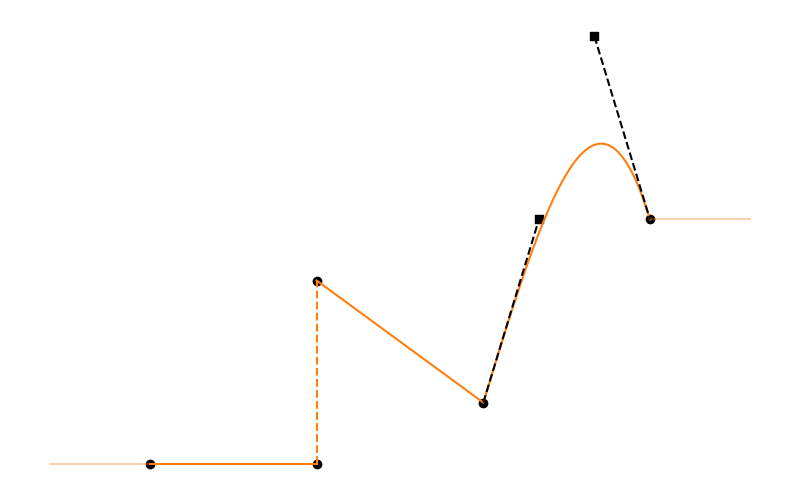
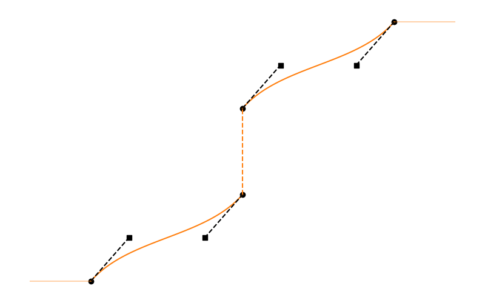
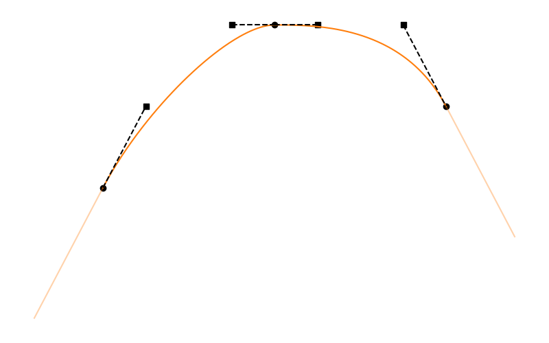
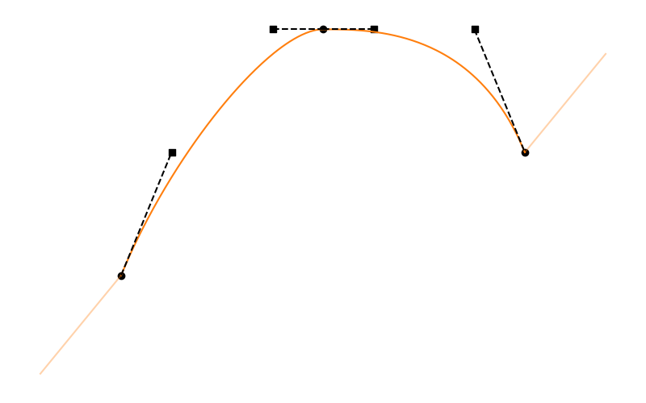
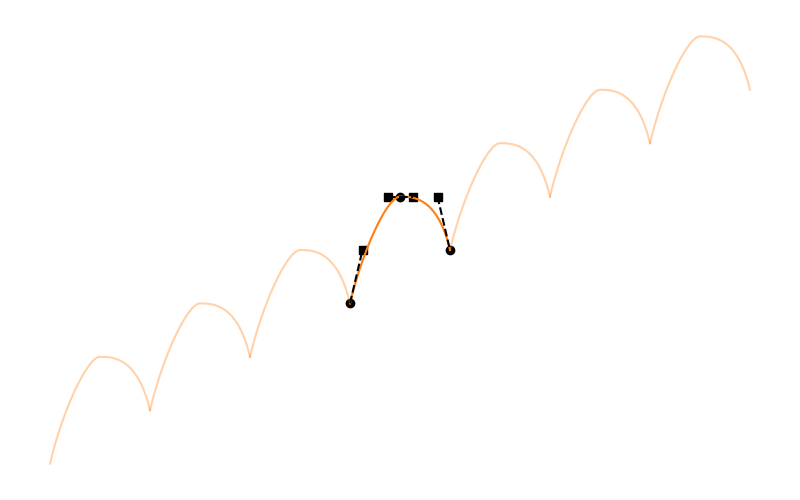
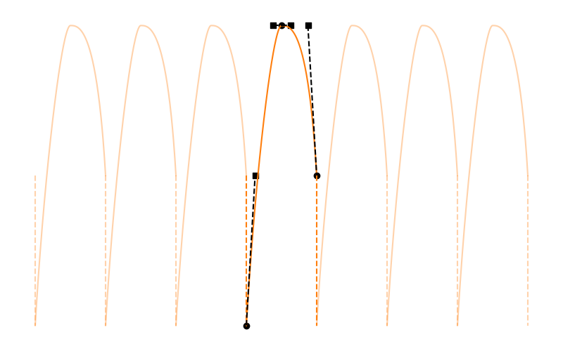
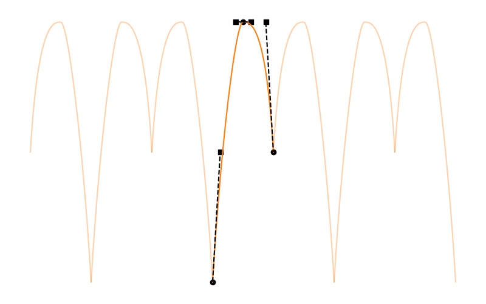
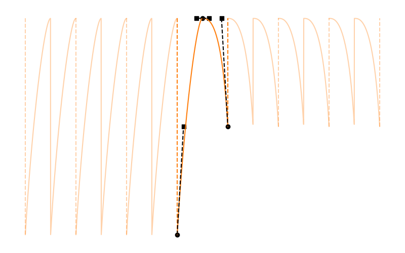
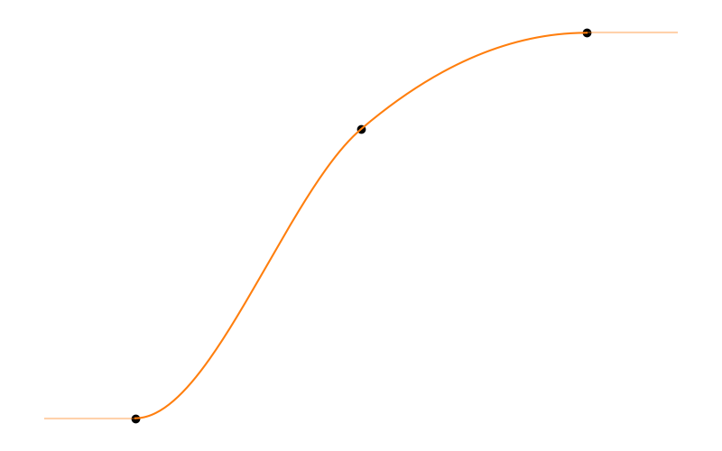

# Splines in Ts {#page_ts_splines}

[TOC]

# Introduction {#splines-introduction}

A `TsSpline` is a mathematical description of a curved function from time to
value.  A spline has _knots_ at unique times, each with a value and controls to
shape the curve between the knots.  The main service a spline provides is
_evaluation_: given a time, what is the value of the curve?

This document is written for developers who use the Ts API: tools that author
splines, and systems that evaluate or display them.  It has four parts:

- **Introduction** (this section): a first look at the model and a short
  example.
- **Features and Capabilities**: what splines can represent.
- **API Guide**: how to do things with `TsSpline`, `TsKnot`, and related
  classes.
- **Appendices**: the mathematics, how evaluation works, implementation notes,
  and other background.

Ts is still in development, and some parts of the API are declared but not yet
implemented.  This document says so where it matters.

## The Model

A spline is built from these pieces:

- **Knots** (`TsKnot`) are the points the curve passes through.  Each knot has
  a time and a value, an interpolation mode, and tangents. A spline's knots are
  unique in time, and are kept sorted.

- **Segments** are the spans of curve between adjacent knots. The knot at the
  start of the segment controls the shape of the segment _after_ it. The
  segment starts at the first knot's time and extends up to, but not including,
  the second knot's time.

- **Interpolation** determines how each segment is shaped. The interpolation
  can be held, linear, curved, or "no value at all".

- **Tangents** shape curved segments.  Each knot has a _pre-tangent_ that
  controls the curve arriving at the knot, and a _post-tangent_ that controls
  the curve leaving it.  A tangent is expressed as a time _width_ and a
  _slope_ (value change over time change).

- **Extrapolation** (`TsExtrapolation`) determines the curve before the first
  knot and after the last.  The default is to hold the end values.

- **Value type**: all knots in a spline hold the same value type. The supported
  types are `double`, `float`, and `GfHalf`, plus `GfTimeCode` and
  `GfDuration` for time-valued splines.

`TsSpline` is a single non-templated class, whatever the value type.  Copying a
spline is cheap, because splines are copy-on-write; see
[Value Semantics](#splines-value-semantics).

## A First Example

The following examples build a spline with three knots and then evaluate it,
first in Python and then the same example in C++.

~~~{.py}
from pxr import Ts

spline = Ts.Spline()

first = Ts.Knot()
first.SetTime(0)
first.SetValue(0)
first.SetNextInterpolation(Ts.InterpCurve)
first.SetPostTanWidth(1)
first.SetPostTanSlope(2)
spline.SetKnot(first)

peak = Ts.Knot()
peak.SetTime(4)
peak.SetValue(5)
peak.SetNextInterpolation(Ts.InterpCurve)
peak.SetPreTanWidth(1.5)
peak.SetPreTanSlope(0)
peak.SetPostTanWidth(1.5)
peak.SetPostTanSlope(0)
spline.SetKnot(peak)

last = Ts.Knot()
last.SetTime(8)
last.SetValue(1)
last.SetPreTanWidth(1)
last.SetPreTanSlope(-2)
spline.SetKnot(last)

print(spline.Eval(4.0))                       # 5.0: the curve passes through
                                              # each knot
print(spline.Eval(2.0))                       # 3.514...: between knots
print(spline.Eval(-10.0), spline.Eval(100.0)) # 0.0 1.0: held outside the knots
~~~

~~~{.cpp}
#include <pxr/base/ts/spline.h>
#include <iostream>

void printValue(const TsSpline& spline, TsTime t)
{
    double value;
    std::cout << "Time " << t << ": ";
    if (spline.Eval(t, &value)) {
        std::cout << value;
    } else {
        std::cout << "-- no value --";
    }
    std::cout << std::endl;
}

int main()
{
    TsSpline spline;

    TsDoubleKnot first;
    first.SetTime(0.0);
    first.SetValue(0.0);
    first.SetNextInterpolation(TsInterpCurve);
    first.SetPostTanWidth(1.0);
    first.SetPostTanSlope(2.0);
    spline.SetKnot(first);

    TsDoubleKnot peak;
    peak.SetTime(4.0);
    peak.SetValue(5.0);
    peak.SetNextInterpolation(TsInterpCurve);
    peak.SetPreTanWidth(1.5);
    peak.SetPreTanSlope(0.0);
    peak.SetPostTanWidth(1.5);
    peak.SetPostTanSlope(0.0);
    spline.SetKnot(peak);

    TsDoubleKnot last;
    last.SetTime(8.0);
    last.SetValue(1.0);
    last.SetPreTanWidth(1.0);
    last.SetPreTanSlope(-2.0);
    spline.SetKnot(last);

    printValue(spline, 4.0);          // 5.0: the curve passes through each knot
    printValue(spline, 2.0);          // 3.514...: between knots
    printValue(spline, -10.0);        // 0.0: held before the knots
    printValue(spline, 100.0);        // 1.0: held after the knots
}
~~~

A few things to notice:

- Knots are copied by value into the spline by `SetKnot`. Changing a `TsKnot`
  object afterward does not change the spline; call `SetKnot` again to replace
  the knot at that time.

- The last knot's interpolation mode doesn't matter, because no segment follows
  it.  Every other knot here uses `TsInterpCurve`; the default is _held_, which
  would draw a staircase.

- Outside the first and last knots, the spline is held at the end values,
  because held is the default extrapolation.

# Features and Capabilities {#splines-features}

## Value Types

Each spline has a value type, which is `double`, `float`, or
`GfHalf` for ordinary splines.  Time-valued splines use `GfTimeCode` or
`GfDuration`; `TsSpline::IsTimeValued` reports whether a spline is one of
these.  Time-valued splines differ from ordinary ones in how they are scaled:
see `TsSpline::GetTimeScaled`.

A default-constructed spline has no value type.  The type becomes established
when `SetValueType` is called or when the first knot is added.  To fix the type
earlier, pass a `TfType` to the constructor.  `TsSpline::CanSetValueType` tests
whether `SetValueType` will succeed or not, and `CanSetKnot` tests whether
setting a particular knot will succeed or not.  `TsSpline::IsSupportedValueType`
tests whether a type can be used as a spline value type at all.

`TsKnot`'s value type is fixed at construction, and a knot can only be added to
an untyped spline or to a spline of the same value type. Adding a knot to an
untyped spline will change the spline's value type to match the knot. The
`TsTypedKnot` family (`TsDoubleKnot`, `TsFloatKnot`, `TsHalfKnot`,
`TsTimeCodeKnot`, `TsDurationKnot`) are C++ conveniences for constructing knots
of a given type.

## Curve Types {#splines-curve-types}

A spline has one _curve type_, set with `TsSpline::SetCurveType`:

- **Bezier** (the default): each curved segment is a cubic Bezier. A Bezier
  curve is defined by 4 control points which are the knots at each end of the
  segment, and the end points of the two tangents. The tangents can be given
  any finite slope and any non-negative widths. The tangents may be adjusted
  to ensure that the curve does not double back on itself (see
  [Anti-Regression](#splines-anti-regression) for more details).

- **Hermite**: like Bezier, but each curved segment is defined by the two end
  points and two slopes. Any provided tangent widths are ignored by the spline.
  The shape of the Hermite curve is exactly the same as that of a Bezier curve
  with tangent widths of 1/3 the segment width, but a Hermite curve can be
  evaluated faster because the mathematics are simpler. Note that if a knot does
  have tangent widths, they will be reset to 1/3 of the segment width when the
  knot is added to a spline. For example, in a Hermite spline with knots at
  times 0 and 6, knots retrieved from the spline will have tangent widths of 2.

Both are cubic polynomials, and a Hermite spline can always be expressed as a
Bezier spline.  The reverse is not true. [Appendix A](#appendix-math) has the
mathematics.

\note `TsKnot` has `SetCurveType` and `GetCurveType` methods too, but these are
deprecated and the knot's curve type is ignored. A knot works in a spline of
either curve type.

## Knots

Each knot carries:

- a **time**
- a **value**
- (optional) a **pre-value**
- a **next interpolation mode** for the segment that follows
- a **pre-tangent** and **post-tangent**, each with a width, a slope, and a
  tangent algorithm
- (optional) **custom data**: a `VtDictionary` for client use.  Custom data does
  not affect evaluation.

Tangent slopes are stored as rise over run.  Some software, notably Maya,
stores tangents in other formats; `TsConvertFromStandardTangent` and
`TsConvertToStandardTangent` convert between them.

## Interpolation Modes

Each knot's `SetNextInterpolation` selects how the segment after it is drawn:

| Mode                  | Segment behavior                                      |
|-----------------------|-------------------------------------------------------|
| `TsInterpHeld`       | Constant at this knot's value, then jumps at the next knot. This is the default. |
| `TsInterpLinear`     | A straight line to the next knot. Tangents are ignored. |
| `TsInterpCurve`      | A Bezier or Hermite curve, according to the spline's curve type. |
| `TsInterpValueBlock` | No value at all; the spline is undefined in this segment. |

A _value block_ is a deliberate absence of a value, which is different than a
value of zero.  Evaluating inside a value block returns false (in C++) or `None`
(in Python).  `TsSpline::HasValueBlocks` and `HasValueBlockAtTime` query for
them.

## Dual-Valued Knots

Normally a knot has one value, and the curve is continuous through it.  A
_dual-valued_ knot has two: a _pre-value_ that the curve approaches from the
left, and a value that it leaves from on the right.  This makes a
discontinuity at the knot.

~~~{.cpp}
    knot.SetValue(4);
    knot.SetPreValue(2);        // now dual-valued
    knot.IsDualValued();        // true
    knot.ClearPreValue();       // back to a single value
~~~

If there is a discontinuity at time t, `Eval(t)` returns the value of the knot
while `EvalPreValue(t)` returns the value of the spline infinitesimally before
time t (mathematically, the limit of the value of the spline as it approaches
time t from the left).

The pre-value only matters when the segment _before_ the knot is linear or
curved.  If that segment is held, it holds the previous knot's value all the
way up to this knot, so the pre-value is simply that value, and this knot's own
pre-value is ignored.

## Extrapolation {#splines-extrapolation}

A spline's _pre-extrapolation_ governs values at times before the first knot,
and its _post-extrapolation_ governs values at and after the last knot's time.
Each is a `TsExtrapolation` with a `mode` and is set on the spline with
`SetPreExtrapolation` or `SetPostExtrapolation`. The default is `TsExtrapHeld`
on both sides.

| Mode                     | Region behavior                                |
|--------------------------|------------------------------------------------|
| `TsExtrapHeld`           | Constant at the end knot's value.  The default. |
| `TsExtrapValueBlock`     | No value.                                      |
| `TsExtrapLinear`         | A straight line leaving the end knot, continuing the slope of the adjacent segment. |
| `TsExtrapSloped`         | A straight line leaving the end knot, with the slope given in `extrapolation.slope`. |
| `TsExtrapLoopRepeat`     | Repeats the knots' curve, offset in value so that each copy begins where the previous one ends. |
| `TsExtrapLoopReset`      | Repeats the curve exactly, with a jump at each join. |
| `TsExtrapLoopOscillate`  | Like Repeat, but every other copy is reversed in time. |

~~~{.cpp}
    extrap = TsExtrapolation(TsExtrapSloped)
    extrap.slope = 0.5
    spline.SetPostExtrapolation(extrap)
~~~

\note Setting `slope` only matters in `ExtrapSloped` mode.  A constructor taking
a mode and a slope exists but is deprecated; set the field instead.

### Linear and Sloped Extrapolation {#splines-linear-extrapolation}

Linear extrapolation continues the curve in a straight line with the same slope
that the spline had at the end knot. If the end segment used linear
interpolation then the extrapolation continues that straight line. If the end
segment was curved, then the slope matches the tangent slope at the end
knot. But if there is any form of discontinuity (a dual-value, a value-block, or
held interpolation) or if there is only a single knot, then the extrapolated
slope is 0.0 (horizontal).

Sloped extrapolation also extrapolates with a straight line, but the slope
of that line is specified explicitly in the `TsExtrapolation` and does not
depend on the slope of the spline itself.

### Looping Extrapolation

The three loop modes repeat the spline's knots in the extrapolation region,
without end.  They differ in what happens at each join:

Looping extrapolation uses the _knots_ of the spline, so editing a knot changes
every copy.  `TsSpline::HasExtrapolatingLoops` reports whether either side
loops, and `TsSpline::GetKnotsWithLoopsBaked` produces explicit knots over a
finite interval, for clients that cannot loop.

By default, a loop repeats the whole knot region.  Setting
`TsExtrapolation::loopBoundaryTime` selects a sub-region.  For
post-extrapolation, the loop is from the boundary time to the last knot; for
pre-extrapolation, it is from the first knot to the boundary time.  In both
cases the repeated region is the one adjacent to the extrapolation.

~~~{.py}
extrap = Ts.Extrapolation(Ts.ExtrapLoopReset)
extrap.loopBoundaryTime = 4.0   # must be a knot time
spline.SetPostExtrapolation(extrap)
~~~

Boundary times that aren't usable are handled as follows:

- A boundary time that is not exactly the time of a knot is _invalid_.  The
  extrapolation region evaluates to a value block.
  `IsPreExtrapolationValid` and `IsPostExtrapolationValid` report this.

- A boundary at the end knot for post-extrapolation (or the first knot for
  pre-extrapolation) leaves nothing to repeat, so the region is held.

## Tangent Algorithms {#splines-tangent-algorithms}

Normally a knot's tangents are whatever the client sets.  A _tangent algorithm_
asks Ts to compute them instead.  Each knot has one algorithm for its
pre-tangent and one for its post-tangent, set with `SetPreTanAlgorithm` and
`SetPostTanAlgorithm`.

| Algorithm                    | Behavior                                   |
|------------------------------|--------------------------------------------|
| `TsTangentAlgorithmNone`     | Use the values set explicitly.  The default. |
| `TsTangentAlgorithmAutoEase` | Compute a smooth tangent from the neighboring knots. |
| `TsTangentAlgorithmCustom`   | Reserved for client-defined algorithms.  <b>Not yet implemented</b>; behaves like None. |

AutoEase is the algorithm of Maya and
[AnimX](https://github.com/Autodesk/animx). It blends the slopes of the lines
from this knot to its neighbors, weighting the nearer neighbor more strongly.
The tangent widths are 1/3 of the distances to the neighbors, so the result is
valid in both Bezier and Hermite splines.  The slope is 0 at the first and last
knots or at any discontinuity (e.g., dual-valued knots, held interpolation, or
value-blocks). It is also 0 when the knot is a local extremum, where the slopes
to the two neighbors have opposite signs.

~~~{.py}
for time, value in ((0, 0), (4, 3), (8, 4)):
    knot = Ts.Knot()
    knot.SetTime(time)
    knot.SetValue(value)
    knot.SetNextInterpolation(Ts.InterpCurve)
    knot.SetPreTanAlgorithm(Ts.TangentAlgorithmAutoEase)
    knot.SetPostTanAlgorithm(Ts.TangentAlgorithmAutoEase)
    spline.SetKnot(knot)

knot = spline.GetKnot(4)
print(knot.GetPostTanWidth())   # 1.333...
print(knot.GetPostTanSlope())   # 0.5
~~~

Some behaviors to be aware of:

- The computation happens when the knot is added to a spline, and again when
  neighboring knots change.  A standalone `TsKnot` keeps its explicit tangent
  values until `TsKnot::UpdateTangents` is called with the would-be neighbors.

- An algorithm overrides explicit values.  Setting a tangent on a knot with an
  algorithm and then adding it to a spline discards the tangent you set.  To
  author a tangent by hand, make sure its algorithm is `None`.

- Tangents are also subject to anti-regression.

## Anti-Regression {#splines-anti-regression}

Bezier tangents that are too long can define a segment that would double back
and would have more than one value at a given time. Ts uses anti-regression
features to prevent these sorts of regressive segments.  Anti-regression
automatically shortens tangents that would cause regressive segments.

See \ref splines-anti-regression-API below and the page
\ref page_ts_regression for full details.

## Value Semantics {#splines-value-semantics}

`TsSpline` behaves like a value type.  Copies are independent and compare by
content:

~~~{.cpp}
    TsSpline copy = spline;    // Lightweight: copy and spline share data
    std::cout << "(copy == spline): " << (copy == spline) << std::endl;

    TsKnot knot = copy.GetKnot(4.0);
    knot.SetValue(99);
    copy.SetKnot(knot);        // Modifying copy duplicates the data
    std::cout << "(copy == spline): " << (copy == spline) << std::endl;

    double value;
    if (spline.Eval(4.0, &value)) {
        std::cout << "spline.Eval(4.0) -> " << value << std::endl;  // 5.0
    }
    if (copy.Eval(4.0, &value)) {
        std::cout << "copy.Eval(4.0) -> " << value << std::endl;    // 99.0
    }
~~~

Copying is cheap, because splines are copy-on-write: a copy shares the
original's data until one of them is modified, and only then pays for
duplicating the knots.  This makes it reasonable to pass splines by value and to
keep several versions of a spline, such as for undo.

Accessors that return knots (`GetKnot`, `GetKnots`) return _copies_.  Editing a
returned knot has no effect until it is put back with `SetKnot`.

\note In C++, a spline's hash is based on the identity of its shared data, not
its content. A copy of a spline will have the same hash as the original but two
splines that happen to have the same contents will compare as equal but hash
differently. In Python, a spline's hash is based on the `id()` of the Python
object and all splines have unique hashes, regardless of their contents.

## Features Not Yet Implemented

Some API methods are declared in the headers but have not yet been implemented. A C++
program that calls these methods will not link, and none of them are bound in Python.

- Spline queries `IsVarying`, `IsLinear`, `IsC0Continuous`, `IsG1Continuous`,
  `IsC1Continuous`, and `GetValueRange`; and the same-named continuity queries
  on `TsKnot`.
- Segment queries `IsSegmentFlat`, `IsSegmentMonotonic`, and `IsKnotRedundant`.
- `ClearRedundantKnots`.

The following features are partially implemented:

- `TangentAlgorithmCustom` is accepted but behaves like None.
- The `affectedIntervalOut` argument of `SetKnot` and `RemoveKnot` is not filled
  in.

## Spline Editing Features

Ts provides several editing features for working with splines. You can bake out
extrapolation loop knots for clients that don't support looping, or sample
splines into polyline approximations for display purposes. You can add
breakdowns to help refine the set of knots while preserving the spline's
shape. You can concatenate and compare (diff) splines. See
[Editing Operations](#splines-editing-operations) for more details.

# API Guide {#splines-api-guide}

This section is organized by task.  It covers the classes `TsSpline`, `TsKnot`,
and `TsKnotMap`; see their reference pages for complete signatures.

## Conventions

**Times and values.**  Times (`TsTime`) are `double`.  Knot times must be
finite.  Values are of the spline's value type and must also be finite.

**Errors.**  Ts reports misuse in two ways:

- Most mutating methods return `bool`.  `false` means the operation did not
  happen.
- Invalid arguments, such as a negative tangent width or a knot of the wrong
  value type, also issue a `TF_CODING_ERROR`.  In Python this surfaces as a
  `Tf.ErrorException`.  The call has no effect.

**Out-parameters.**  C++ methods that produce a value return `bool` and fill in
a pointer.  The Python bindings return the value instead, or `None` when there
is no value:

| C++                                    | Python                       |
|----------------------------------------|------------------------------|
| `bool Eval(time, &value)`              | `value = spline.Eval(time)`  |
| `bool GetKnot(time, &knot)`            | `knot = spline.GetKnot(time)` |
| `bool Breakdown(time, &interval)`      | `interval = spline.Breakdown(time)` |
| `bool CanBreakdown(time, &reason)`     | `ok, reason = spline.CanBreakdown(time)` |
| `bool Sample(interval, ..., &samples)` | `samples = spline.Sample(interval, ...)` |

**Python value types.** In Python, value types can be a string (e.g.,
`"double"`, `"float"`, or `"timecode"`) or a `Tf.Type` value. In C++, use a
`TfType`.

**What the Python bindings omit.** The Python bindings omit the `TsTypedKnot`
helpers. In Python use `Ts.Knot("double")` instead of the C++ equivalents of
`TsTypedKnot<double>` or `TsDoubleKnot`. Note that in both C++ and Python, a
default constructed knot (`TsKnot()` or `Ts.Knot()`) defaults to a value type
of "double".

## Creating Splines

~~~{.py}
spline = Ts.Spline()            # no specific value yet
spline = Ts.Spline("float")     # float-valued
spline.GetValueTypeName()       # 'float'
Ts.Spline.IsSupportedValueType("int")   # False
~~~

Once a spline has a value type, it keeps it, even after `ClearKnots`; setting a
knot of another type is a coding error.  A default-constructed `TsSpline` has no
value type until `SetValueType` is called or its first knot is set;
`GetValueType` returns an unknown `TfType` until then.

`IsHolding<T>()` is a C++ convenience method that tests the value type of a
created spline without requiring the caller to construct a `TfType`.

## Creating and Editing Knots

A `TsKnot` is a small value object.  Create one, set its attributes, and give
it to a spline.

~~~{.cpp}
    TsSpline spline;

    TsKnot knot;                    // Default has value type of double
    knot.SetTime(4);
    knot.SetValue(5);
    knot.SetNextInterpolation(TsInterpCurve);
    knot.SetPreTanWidth(1.5);
    knot.SetPreTanSlope(0);
    knot.SetPostTanWidth(1.5);
    knot.SetPostTanSlope(0);

    spline.SetKnot(knot)
~~~

The setters return `bool`.  These are the knot attributes:

| Attribute        | Methods                                                 |
|------------------|---------------------------------------------------------|
| Time             | `SetTime`, `GetTime`                                    |
| Value            | `SetValue`, `GetValue`                                  |
| Pre-value        | `SetPreValue`, `GetPreValue`, `ClearPreValue`, `IsDualValued` |
| Next interpolation | `SetNextInterpolation`, `GetNextInterpolation`        |
| Pre-tangent      | `SetPreTanWidth`, `SetPreTanSlope`, `SetPreTanAlgorithm` and getters |
| Post-tangent     | `SetPostTanWidth`, `SetPostTanSlope`, `SetPostTanAlgorithm` and getters |
| Custom data      | `SetCustomData`, `SetCustomDataByKey`, and getters      |

Some details:

- A new knot has time 0, value 0, held interpolation, zero-width tangents, and
  tangent algorithm None.

- `SetValue` in C++ requires a value of the correct type.  If the value type is
  `float`, you need to explicitly pass a float value (e.g.,
  `knot.SetValue(1.0f)`) or the call will fail with a coding error. Python does
  not have native support for 32-bit or 16-bit floating point values, so the
  Python bindings will convert floating point values to the correct type.

- Invalid values (negative tangent widths, or infinite values) will also result
  in coding errors.

- The pre-value is the value approaching the knot from the left. Setting it
  makes the knot dual-valued.  `GetPreValue` on a knot that isn't dual-valued
  returns the knot's ordinary value.

- Custom data is a `VtDictionary`.  `SetCustomDataByKey` and `GetCustomDataByKey`
  accept key paths in
  which `:` separates nested dictionaries:

~~~{.py}
knot.SetCustomDataByKey("tool:color", "red")
knot.GetCustomData()                   # {'tool': {'color': 'red'}}
knot.GetCustomDataByKey("tool:color")  # 'red'
~~~

  Custom data travels with the knot into a spline and back out but does not
  affect evaluation.

### Computing Tangents Without a Spline

A knot's tangent algorithms normally run when the knot is put into a spline.
`TsKnot::UpdateTangents` runs them immediately, given the knots that would be
on either side:

~~~{.py}
before, after = Ts.Knot(), Ts.Knot()
after.SetTime(8); after.SetValue(4)
knot.SetTime(4); knot.SetValue(3)
knot.SetPostTanAlgorithm(Ts.TangentAlgorithmAutoEase)
knot.UpdateTangents(before, after, Ts.CurveTypeHermite)      # True
knot.GetPostTanSlope()                                       # 0.5
~~~

The neighbors must be at earlier and later times, or a coding error is issued
and nothing changes. The curve type argument is optional and defaults to
assuming that the knots should be treated as if they were in a Bezier spline.

### Converting Tangent Formats

Other packages store tangents differently.  `TsConvertFromStandardTangent`
and `TsConvertToStandardTangent` convert between Ts's width-and-slope form and
others, with flags for converting slope to height, scaling by three, and
negating the height.  For instance, with the flags below, a tangent of width 1
and slope 2 becomes a width of 3 and a height of 6: the slope is turned into a
height (slope times width, here 2), and the width and height are then
multiplied by three:

~~~{.py}
Ts.ConvertFromStandardTangent(1.0, 2.0, True, True, False)   # (3.0, 6.0)
~~~

## Putting Knots in a Spline

| Method                 | Effect                                             |
|------------------------|----------------------------------------------------|
| `SetKnot(knot)`        | Inserts the knot, or replaces the knot at the same time. |
| `SetKnots(knotMap)`    | Replaces all knots at once.                        |
| `RemoveKnot(time)`     | Removes the knot at that time, if any.             |
| `ClearKnots()`         | Removes all knots.  Keeps value type and other settings. |
| `CanSetKnot(knot)`     | (C++) Tests whether `SetKnot` would succeed, with a reason. |

`SetKnot` copies the knot.  If the knot's value type doesn't match the spline's,
it issues a coding error and returns `false` (in Python, the coding error is
raised as an exception).  The `affectedIntervalOut` argument is not yet filled
in, and in Python `SetKnot` returns an empty `GfInterval`. After inserting the
knot, SetKnot applies any tangent algorithms and anti-regression that affect the
knot and its neighbors (see [Tangent Algorithms](#splines-tangent-algorithms)
and [Anti-Regression](#splines-anti-regression-API)). Because of this, the tangents
stored in the spline can differ from those on the knot you passed in.

~~~{.py}
spline.SetKnot(knot)
spline.GetKnot(4).GetPreTanWidth()    # read back what the spline actually holds
~~~

To build a spline from many knots at once, use a `TsKnotMap`.

### TsKnotMap

`TsKnotMap` is a sorted collection of knots with unique times.  In C++ it
combines `std::vector` iteration, `std::map` lookup (`find`, `lower_bound`,
`erase(time)`), and a few extras: `FindClosest`, `GetTimeSpan`, `GetValueType`,
and `HasCurveSegments`. In Python, a `Ts.KnotMap` behaves like a `dict` that
maps from time to knot.

This leads to a few behavioral differences between `TsKnotMap` in C++ and
`Ts.KnotMap` in Python. In particular, in C++ iterating over the knot map will
yield a sequence of `TsKnot` objects and inserting a knot at the same time as an
existing knot will not update the knot. In Python, iterating over the knot map
will yield a sequence of knot time values and using `knotMap[time] = knot` will
replace an existing knot with the new one.

~~~{.py}
knotMap = Ts.KnotMap()
for knot in knots:
    knotMap[knot.GetTime()] = knot

len(knotMap)                    # 3
4.0 in knotMap                  # True
list(knotMap.keys())            # [0.0, 4.0, 8.0]
knotMap[4.0].GetValue()         # 5.0
knotMap.FindClosest(5.0)        # the knot at time 4.0
knotMap.GetTimeSpan()           # [0, 8]

spline.SetKnots(knotMap)
~~~

A `TsKnotMap` holds copies of knots; editing one has no effect on the spline it
came from.  `SetKnots` requires the map's value type to match the spline's, and
a coding error results if it doesn't.  The type of an empty map is unknown, so
it can't be used to clear a spline; call `ClearKnots` instead.

## Reading Knots

~~~{.py}
spline.GetKnot(4.0)                     # a Ts.Knot, or None if there is none
spline.GetKnots()                       # a KnotMap of all knots in the spline
spline.GetKnots(Gf.Interval(5, 6))      # knots that affect that interval
spline.IsEmpty()                        # True if there are no knots
~~~

`GetKnot` finds exact matches only. `GetKnots(interval)` returns every knot that
influences the curve in the interval, which includes knots outside the interval
whose segments or tangents reach into it.  In the example above, the interval
from 5 to 6 lies in the segment between the knots at 4 and 8, so it returns
both. `GetKnots` is not affected by extrapolation modes; it only returns knots
that affect segments between the first and last knot times.

All of these return copies.

## Spline-Wide Settings

~~~{.py}
spline.SetCurveType(Ts.CurveTypeHermite)
spline.SetPostExtrapolation(extrapolation)
spline.GetPreExtrapolation().mode
~~~

See [Curve Types](#splines-curve-types) and
[Extrapolation](#splines-extrapolation).

Switching a spline to Hermite rewrites the stored tangent widths of its knots to
1/3 of the width of the segment they belong to, and `SetKnot` does the same for
knots added afterward.  Switching back to Bezier does not restore the original
widths.  Tangent widths at the outer sides of the first and last knots, which
belong to no segment, are left alone.

\note Changing a spline from Bezier to Hermite is likely to change the shape
of the spline, but changing from Hermite to Bezier does not. This is because
every Hermite curve can be represented as a Bezier but the converse is not true.

## Evaluation

`Eval` returns the value of the spline at a time.

~~~{.py}
spline.Eval(2.0)             # 3.514...
spline.Eval(-10.0)           # extrapolated
Ts.Spline().Eval(1.0)        # None: an empty spline has no values
~~~

It returns `None` (or `false` in C++) when the spline has no value there: the
spline is empty, or the time lies in a value block.

These related methods share the same conventions:

| Method               | Returns                                            |
|----------------------|----------------------------------------------------|
| `Eval`               | The value at the time.                             |
| `EvalPreValue`       | The value approaching the time from the left.      |
| `EvalDerivative`     | The slope at the time.                             |
| `EvalPreDerivative`  | The slope approaching the time from the left.      |
| `EvalHeld`           | The value as though every segment were held.       |
| `EvalPreValueHeld`   | The pre-value as though every segment were held.   |

Between knots, the value and pre-value are the same. At a knot they can differ
if the knot is dual-valued or the segment on the left side is held. `Eval`
reports the knot's value and `EvalPreValue` reports the knot's pre-value. More
specifically and mathematically, `Eval` reports the limit of the value of the
spline as the knot's time is approached from the right while `EvalPreValue`
reports the limit as the knot's time is approached from the
left. `EvalDerivative`/`EvalPreDerivative` and `EvalHeld`/`EvalPreValueHeld`
behave similarly.

This has a consequence at the last knot. The knot's right side belongs to the
post-extrapolation region.  If that is a value block, `Eval` at the last knot's
time returns `None`, while `EvalPreValue` still returns the knot's (pre-)value:

~~~{.py}
spline.SetPostExtrapolation(Ts.Extrapolation(Ts.ExtrapValueBlock))
spline.Eval(8.0)             # None
spline.EvalPreValue(8.0)     # 1.0
~~~

**Held evaluation** ignores the shape of the curve and reports the value that a
"stepped" version of the spline would have.  It is useful for previewing
animation in a blocking style.  `EvalHeld(t)` is the value of the knot at or
before `t`; `EvalPreValueHeld(t)` is the same but for times strictly before `t`.

**Derivatives** are with respect to time.

In C++, the output pointer of each evaluation method may point to the spline's
value type or to a `VtValue`:

~~~{.cpp}
double value;
if (spline.Eval(2.0, &value)) {
    // ...
}

VtValue vtValue;
spline.Eval(2.0, &vtValue);      // holds the spline's own type
~~~

\note A spline that has regressive segments (which must have been authored with
anti-regression disabled) evaluates as though Keep Ratio had been applied. The
knot tangents themselves are not changed.

## Sampling for Display

`Eval` computes one value.  `Sample` computes many, as a set of polylines whose
straight edges approximate the curve to a tolerance.  `Sample` is designed for
drawing curves on a display.

~~~{.py}
samples = spline.Sample(Gf.Interval(0, 8),
                        timeScale=100.0, valueScale=100.0, tolerance=1.0)
for polyline in samples.polylines:
    for vertex in polyline:      # Gf.Vec2d(time, value)
        ...
~~~

The three scale arguments say how time and value map to your sampling
coordinates. If `timeScale` and `valueScale` are pixels per unit, then
`tolerance` is the largest allowed error, in pixels.  A polyline is within the
tolerance of the true curve wherever it is drawn in that scaling.

- The interval must be non-empty and finite, and the scales and the tolerance
  must be positive.  Otherwise a coding error is issued and the call fails.

- A new polyline begins at each discontinuity: a dual-valued knot, a held
  segment's jump, and the edges of value blocks.  Value-blocked regions produce
  no vertices (or sources) at all.

In C++, `Sample` is a method templated on a `Vertex` type. Call it with an
output argument that is either a `TsSplineSamples<Vertex>` or a
`TsSplineSamplesWithSources<Vertex>`. The `Vertex` type must be a `GfVec2d`,
`GfVec2f`, or `GfVec2h`. If `Sample` is called with a `TsSplineSamples<Vertex>`,
then it will return just the polylines that make up the sampled curve. If it is
called with a `TsSplineSamplesWithSources<Vertex>`, then the "source" of each
polyline will also be returned as a vector of `TsSplineSampleSource` values.

~~~{.cpp}
// C++
TsSplineSamplesWithSources<GfVec2f> result;

if (spline.Sample(GfInterval(-2, 10), 100.0, 100.0, 1.0, &result)) {
    for (size_t i = 0; i < result.polylines.size(); ++i) {
        // Draw polylines differently based on their source.
        Display(result.polylines[i], result.sources[i]);
    }
}
~~~

In Python, `Sample` cannot be a templated method. Instead, it has a keyword
argument named `withSources` that you can set to `True` to get sources or (the
default) `False` to just get the polylines. The returned value will be a
`Ts.SplineSamples` or a `Ts.SplineSamplesWithSources` depending on the value of
`withSources`.

~~~{.py}
# Python
result = spline.Sample(Gf.Interval(-2, 10), 100.0, 100.0, 1.0,
                       withSources=True)
result.sources
# [Ts.SourcePreExtrap, Ts.SourceKnotInterp, Ts.SourcePostExtrap]
~~~

\see TsSpline::Sample

## Editing Operations {#splines-editing-operations}

### Breakdown

A _breakdown_ adds a knot at a time between existing knots without changing the
shape of the curve. Animators call this "inserting a key on a curve".

~~~{.py}
ok, reason = spline.CanBreakdown(2.0)   # (True, '')
interval = spline.Breakdown(2.0)        # Gf.Interval [0, 4], or None on failure
list(spline.GetKnots().keys())          # [0.0, 2.0, 4.0, 8.0]
~~~

`Breakdown` may adjust neighboring knots' tangents to preserve the curve's
shape. The returned interval is the span of the curve that may have changed.

`Breakdown` fails if there is already a knot at the time, or if the time lies in a
looped extrapolation region.  Failure issues a warning, so ask `CanBreakdown`
first when you aren't sure; the reason it returns is the text of that warning.

\see TsSpline::Breakdown

### Truncation

`GetTruncated(interval, preExtrap, postExtrap)` returns a new spline that covers
only the given time interval.  The original is not changed.

~~~{.py}
block = Ts.Extrapolation(Ts.ExtrapValueBlock)
piece = spline.GetTruncated(Gf.Interval(2, 6), block, block)
list(piece.GetKnots().keys())    # [2.0, 4.0, 6.0]
piece.Eval(1.0)                  # None: outside the interval
~~~

If an end value of the interval is infinite, the new spline preserves the
original spline's extrapolation. Otherwise, a knot is added at the interval's
end time and the provided pre- or post-extrapolation arguments define the new
spline's extrapolation (a value-block in the example above).

\see TsSpline::GetTruncated

### Scaling and Shifting Time

`GetTimeScaled(scale, offset)` multiplies knot times by `scale` and then adds
`offset`.

~~~{.py}
scaled = spline.GetTimeScaled(2.0, 10.0)
list(scaled.GetKnots().keys())   # [10.0, 18.0, 26.0]
scaled.Eval(18.0)                # 5.0, as spline.Eval(4.0)
~~~

Tangent widths scale to match, so the shape is stretched uniformly.  A
negative scale reverses the spline in time; a scale of zero is an error.  On
time-valued splines, the values scale as well. See the reference page for how
slopes are treated.

\note Negative scales may produce splines that are slightly different from
evaluating with a negatively scaled time. Knots can have pre-values but they
cannot have post-values. So discontinuities occur on the other side of the knot
after negative scaling.

\see TsSpline::GetTimeScaled

### Concatenation

`TsSpline::Concatenate(splines)` joins splines end to end into one.  Each
spline's last knot must be at the same time as the next spline's first knot.
The joined knot takes its pre-value and pre-tangent from the earlier spline and
its value and post-tangent from the later one, so the joined knot may be
dual-valued if they differ.  All splines must have the same value type or a
coding error will be issued and an empty spline returned.  The pre-extrapolation
of the first spline and post-extrapolation of the last carry over to the result.

\note The result is built using the current anti-regression authoring mode, so
tangents may be adjusted if the input splines are regressive.

\see TsSpline::Concatenate

### Comparison

`Diff` finds where two splines differ, as a time interval.

~~~{.py}
before = Ts.Spline()
for time in range(5):               # linear knots at 0, 1, 2, 3, 4
    knot = Ts.Knot()
    knot.SetTime(time)
    knot.SetValue(time)
    knot.SetNextInterpolation(Ts.InterpLinear)
    before.SetKnot(knot)

after = Ts.Spline(before)
knot = after.GetKnot(2)
knot.SetValue(9)                    # change one knot
after.SetKnot(knot)

before.Diff(after)                                # Gf.Interval [1, 3)
before.Diff(after, Gf.Interval(3, 4)).IsEmpty()   # True: no change in 3..4
~~~

`Diff` is conservative.  It compares segment by segment and never misses a
change, but can report a difference between splines that evaluate identically,
such as a linear segment with zero slope against a held one.  Changing one
knot's value reports both segments touching it, which is why the example above
is `[1, 3)` for a change at 2.

An empty result means no differences.  This makes `Diff` useful for finding out
how much of a curve needs redrawing or recomputing after an edit.

\see TsSpline::Diff

### Baking Loops

`GetKnotsWithLoopsBaked(interval)` returns a `KnotMap` of explicit knots that
reproduce the spline, including its looping extrapolation, over a _finite_
interval.  Use it to hand a looping spline to software that doesn't support
loops.

~~~{.py}
# The spline has knots at 0, 4, and 8.
repeat = Ts.Extrapolation(Ts.ExtrapLoopRepeat)
spline.SetPreExtrapolation(repeat)
spline.SetPostExtrapolation(repeat)

baked = spline.GetKnotsWithLoopsBaked(Gf.Interval(-8, 16))
list(baked.keys())    # [-8.0, -4.0, 0.0, 4.0, 8.0, 12.0, 16.0]
~~~

Without looping extrapolation, the result is just the spline's own knots.

An infinite interval on a spline with extrapolating loops is a coding error,
because it would produce infinitely many knots.

\see TsSpline::GetKnotsWithLoopsBaked

## Spline Queries

Use the following methods for querying spline configuration.

| Method                      | Reports                                      |
|-----------------------------|----------------------------------------------|
| `IsEmpty`                   | There are no knots.                          |
| `HasValueBlocks`            | Any segment or extrapolation is a value block. |
| `HasValueBlockAtTime(time)` | The time falls in a value block.             |
| `HasExtrapolatingLoops`     | Either extrapolation is a looping mode.      |
| `HasLoops`                  | `HasExtrapolatingLoops` (or the deprecated inner loops.) |
| `IsPreExtrapolationValid`, `IsPostExtrapolationValid` | Whether a loop's boundary time is usable. |
| `IsTimeValued`              | The value type is `GfTimeCode` or `GfDuration`. |
| `HasRegressiveTangents`     | Some segment would regress (or exceed its interval, in Contain mode). |

## Anti-Regression API {#splines-anti-regression-API}

To prevent splines from containing segments that loop back upon themselves,
an anti-regression algorithm is applied to tangents when knots are added to
a spline.

There are several different algorithms for adjusting the tangents. They are
documented in \ref anti-regression-strategies. The default
is `TsAntiRegressionKeepRatio` which shortens the tangents on both ends of the
segment while preserving the ratio of their lengths.

In C++, a `TsAntiRegressionAuthoringSelector` is an RAII object that selects
a particular anti-regression strategy while the object is in scope.

In Python, a `Ts.AntiRegressionAuthoringSelector` is a context manager used
in a `with` statement to provide a similar scoped selection of a particular
anti-regression strategy.

When splines are edited while the authoring selector is active, they will adjust
their knots as necessary by using that particular anti-regression strategy.

There are several different algorithms that can be controlled
with a `TsAntiRegressionAuthoringSelector` to change the default algorithm
to one that matches Maya, Houdini, Blender, or other applications.

Editing methods apply the current anti-regression strategy automatically. The
methods that clients call directly are:

~~~{.py}
Ts.Spline.GetAntiRegressionAuthoringMode()   # Ts.AntiRegressionKeepRatio
spline.HasRegressiveTangents()
spline.AdjustRegressiveTangents()            # True if anything changed

with Ts.AntiRegressionAuthoringSelector(Ts.AntiRegressionContain):
    spline.SetKnot(knot)       # edited using Contain strategy
~~~

See `TsRegressionPreventer` or \ref page_ts_regression for more details.

## Printing and Hashing

`str(spline)` in Python, or `operator<<` in C++, gives a readable dump of the
spline's settings and knots, which is useful when debugging.

In C++, `TsSpline` can be hashed with `TfHash`.  The hash is based on the
identity of the shared data and not its contents; see
[Value Semantics](#splines-value-semantics), which also notes how Python
differs.

# Appendices

This section is intended for developers who want to understand the underlying
behavior of Ts or contribute to its development. Nothing here is needed to use
the API.

## Appendix A: Bezier and Hermite Mathematics {#appendix-math}

### Segment control points

A curved segment runs from knot 0 (at time `t0`, value `v0`) to knot 1 (at time
`t1`, value `v1`).  Let `w0` be the post-tangent width of knot 0 and `m0` its
post-tangent slope; let `w1` be the pre-tangent width of knot 1 and `m1` its
pre-tangent slope.  A tangent's _height_ is its width times its slope.  The
segment is a cubic Bezier curve with four control points:

~~~
P0 = (t0,      v0)             knot 0
P1 = (t0 + w0, v0 + w0*m0)     the end of knot 0's post-tangent
P2 = (t1 - w1, v1 - w1*m1)     the end of knot 1's pre-tangent
P3 = (t1,      v1)             knot 1
~~~

If knot 1 is dual-valued then `v1` is its pre-value rather than its value.

### Parametric form

Each coordinate is a cubic polynomial of a parameter `u` in [0, 1]:

~~~
x(u) = (1-u)^3 x0 + 3(1-u)^2 u x1 + 3(1-u) u^2 x2 + u^3 x3
y(u) = (1-u)^3 y0 + 3(1-u)^2 u y1 + 3(1-u) u^2 y2 + u^3 y3
~~~

In power form, `x(u) = a u^3 + b u^2 + c u + d`, with

~~~
a =   -x0 + 3 x1 - 3 x2 + x3
b =  3 x0 - 6 x1 + 3 x2
c = -3 x0 + 3 x1
d =    x0
~~~

and the same for `y`.  A spline is a function of time, but this curve is a
function of `u`.  To evaluate it at a time `t`, Ts must first find the `u` at
which `x(u) = t`, and then compute `y(u)`.

### Finding u for a given time

Solving `x(u) - t = 0` is a cubic equation. Ts normalizes it to
`u^3 + B u^2 + C u + D = 0` and solves it in closed form with Cardano's
algorithm, in `_FindMonotonicZero` in `eval.cpp`:

- If `a` and `b` are both zero (or nearly so), the cubic is really linear
  and `u = -d / c`.
- If only `a` is near zero, it is a quadratic, solved with the quadratic
  formula.
- Otherwise, the discriminant `(q/2)^2 + (p/3)^3` decides between one, two, and
  three real roots.  Three roots use the trigonometric form.

The method relies on `x(u)` being _monotonic_ over [0..1], which is exactly the
guarantee that anti-regression provides.  With a monotonic `x`, there is exactly
one root in [0..1]. If numerical error puts the answer slightly outside [0..1],
it is clamped, and a warning is issued if it is far outside. Similarly,
numerical round-off error _can_ result in several roots in [0..1], even after
the anti-regression algorithm has been applied. In this case, Ts picks the root
nearest 0.5 and emits a warning.

### Hermite segments

A Hermite segment is a cubic that is given by its end points and end slopes. Ts
evaluates it directly, by normalizing time to `u = (T - t0) / dt`, with
`dt = t1 - t0`. No root-finding is needed, because time is linear in `u`.

~~~
u = (T - t0) / dt
um0 = m0 * dt          slopes scaled to the unit interval
um1 = m1 * dt
a = -2 (v1 - v0) + um0 + um1
b =  3 (v1 - v0) - 2 um0 - um1
c = um0
d = v0
v(T)  = a u^3 + b u^2 + c u + d
v'(T) = (3a u^2 + 2b u + c) / dt
~~~

A Hermite segment is the same curve as the Bezier segment whose tangent widths
are both `dt / 3`.  We checked this numerically: for a three-knot spline, the
largest difference between Hermite evaluation and Bezier evaluation with
widths of a third is about 1e-15.  This is why Hermite splines can never
regress, and why `SetCurveType(Hermite)` rewrites widths to a third of the
segment.

### Derivatives

The slope of the curve is the ratio of two parametric derivatives:

~~~
dy/dx = (dy/du) / (dx/du)
~~~

Each derivative is a quadratic: `3a u^2 + 2b u + c`. For Hermite curves,
`dx/du` is a constant (since `t` is just a linear function of `u`).

## Appendix B: How Evaluation Works {#appendix-eval}

`TsSpline::Eval` and its relatives all end up in one function, `Ts_Eval`.  It
takes an _aspect_ (value, held value, or derivative) and a _location_ (the
pre side, or the post side).  `Eval` is the post side at the exact time;
`EvalPreValue` is the pre side.

Evaluation uses the following steps:

1. **Empty check.**  A spline with no knots has no value.

2. **Loop resolution.**  If the spline loops, `_LoopResolver` first maps the
   requested time into the part of the spline that really has knots (below).

3. **Locate the knots.**  A binary search over the sorted vector of knot times
   (`lower_bound`) finds the knot at the time, if any, and the knots before and
   after it.  This vector exists separately from the knot structs so the search
   touches only contiguous doubles.

4. **Choose a case:**

   - _At a knot:_ return the knot's value, or its pre-value when evaluating the
     pre side.  Special cases: a held segment before the knot makes the pre
     value the previous knot's value; value blocks and blocked extrapolation
     return no value.  Derivatives come from the tangent slope, the linear
     segment's slope, zero for held, or the extrapolation slope at the ends.
   - _Before the first knot_ or _after the last:_ extrapolate (Appendix B.2).
   - _Between knots:_ interpolate, using the first knot's `nextInterp`.  Held
     returns the first knot's value; linear draws a straight line; curve calls
     the Bezier or Hermite code in [Appendix A]{#appendix-math}.

5. **Apply the loop's offset.**  Add the value offset and negate if the loop
   resolver says so.

All the math is done in `double`, whatever the spline's value type.  Knot data
of type `T` is converted with `GetKnotDataAsDouble`, and the caller converts the
result back to `T`.  Only the stored knot values and slopes have the
precision of `T`; intermediate results do not.

### B.1 Anti-regression at evaluation time

Before evaluating a Bezier segment, `_EvalBezier` copies the two knots and runs
the Keep Ratio strategy on the copy.  If the segment was already
non-regressive, nothing changes.  If it wasn't, the evaluation behaves as
though the tangents had been shortened.  The spline's stored knots are never
modified.  Sampling does the same for every Bezier segment.

### B.2 Non-Looping Extrapolation

Outside the knots, the extrapolated curve is a straight line from the end knot,
so the only question is the slope (`_GetExtrapolationSlope`):

| Mode    | Slope                                                          |
|---------|----------------------------------------------------------------|
| Block   | none (no value)                                                |
| Held    | 0                                                              |
| Sloped  | the `slope` field                                              |
| Linear  | depends on the segment next to the end knot, as described in [Linear Extrapolation](#splines-linear-extrapolation) |

The value is `end value + slope * (T - end time)`.

### B.3 Looping extrapolation

Rather than build copies of the knots, `_LoopResolver` moves the time to be
evaluated into the original ("prototype") region, and then corrects the result.
Let `span` be the length of the looped region (all the knots, or the part
chosen by `loopBoundaryTime`).  For a time `offset` beyond the edge of the
region:

1. The number of hops is one more than the number of whole spans in `offset`
   (the integer part of `offset / span`), except when the time is exactly on an
   iteration boundary and we are evaluating the side adjacent to the prototype;
   then it is just the whole spans.  The time is hopped back into the
   prototype region by that many spans.

2. **Repeat** adds a value offset: each iteration begins at the value at which
   the previous one ended, so the correction is the loop's total rise (last
   value minus first value) times the number of hops, applied in the direction
   opposite to the hop.  Derivatives need no offset.

3. **Reset** is like **Repeat** but the value offset is always zero. Because the
   pre side and post side of an iteration boundary are not adjusted to match,
   there is a natural discontinuity at each join.

4. **Oscillate** reflects the time within the region on every odd iteration,
   swaps the pre and post sides, and negates derivatives.

If `loopBoundaryTime` isn't a knot time, the region is flagged invalid and the
evaluation returns no value.  If it repeats a region of zero length, the
extrapolated value is effectively held.

## Appendix C: Sampling {#appendix-sampling}

`TsSpline::Sample` produces polylines that approximate the curve.  It walks the
spline's segments in order, using a segment iterator, and handles each by type:

- _Value-block:_ skipped.
- _Held, linear, and extrapolation:_ already straight; emitted as one edge, with
  infinite extrapolation clipped to the requested time interval.
- _Bezier and Hermite:_ subdivided adaptively (below).

For a curved segment, the sampler multiplies the control points by `timeScale`
and `valueScale`, so that distances are in display units.  It then measures how
far control points P1 and P2 lie from the straight line P0 to P3.  A Bezier
curve lies within the convex hull of its four control points, so if both P1 and
P2 are within `tolerance` of that line, the entire line is within tolerance of
the curve, and the segment is emitted as a single edge.  If not, the curve is
split at `u = 0.5` using de Casteljau subdivision, and each half is sampled the
same way. Only halves that intersect the requested interval are considered.

Because the test uses the control points rather than the curve itself, the
measured distance is an upper bound on the true distance between the curve and
the chord.  It may subdivide more than strictly necessary.

## Appendix D: Regenerating the Figures {#regenerating-the-figures}

The figures in this document are produced by the commands in `genDocImages.py`.
From the Ts library directory:

~~~{.sh}
python script/genDocImages.py
~~~

Most figures are made by `script/docGraph.py`, which builds a small spline in
Python and graphs it using the TsTest framework.  Use `docGraph.py --list` to
see the available cases.  Figures of the fixed Museum splines are made by
`script/museumGraph.py` instead.
